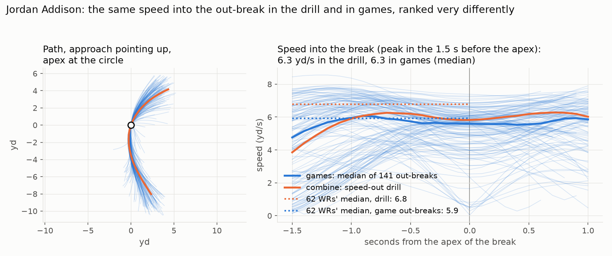
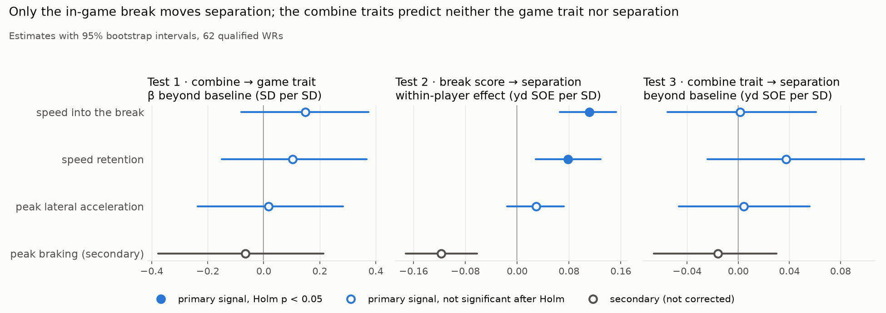
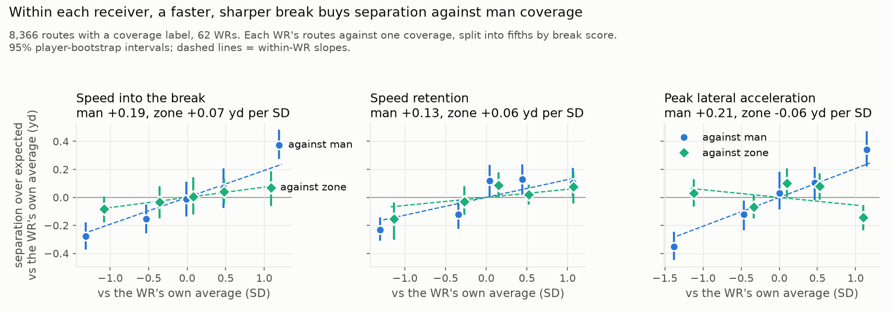
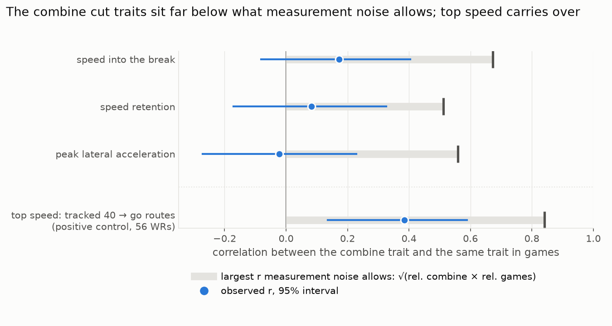
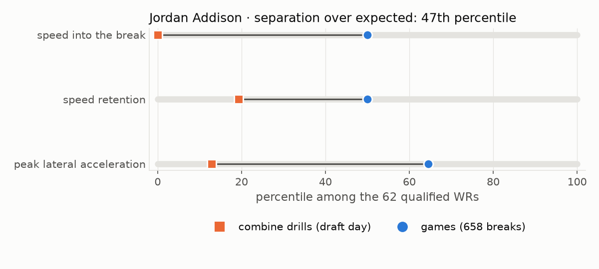
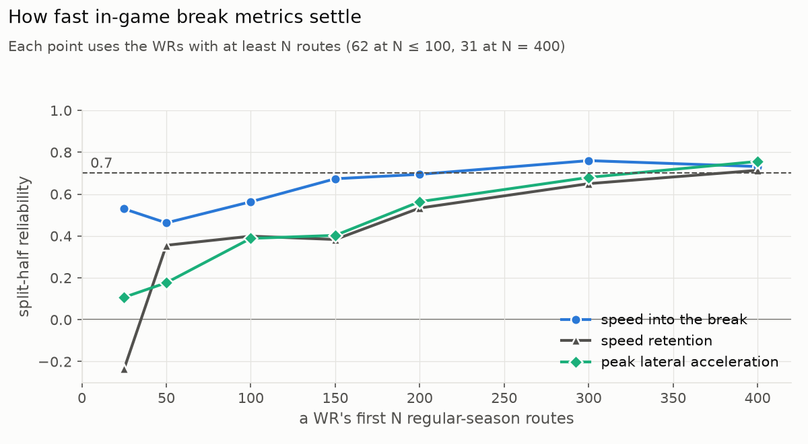

# The cut that doesn't travel: what Combine route drills miss about NFL route breaks

## 1. Why cutting, and why the Combine

A receiver gets open at the break. The stem sells one route, the plant converts speed into a turn, and the defender
either stays in phase or doesn't. Scouts watch that break closely, and the Combine's position drills are the only
time a draft class's receivers run the same breaks, on the same field, under the same tracking.

The 2027 Big Data Bowl adds 10 Hz tracking to those drills, so the break can finally be measured rather than eyeballed.
This entry asks one narrow question for wide receivers: **does the way a receiver breaks in the Combine route drills
carry into how they break in regular-season games, and into how open they get?** Every claim has to beat what teams
already have: draft slot and the standard tests (40, 10-yard split, vertical, broad jump, height, weight).

The short answer is no. The combine cut doesn't travel, at least not in a way 16 drill cuts per player can detect,
even though the same pipeline does see top speed carry over. But the same mechanics measured in games do matter,
mostly against man coverage: there, a receiver's best breaks come out about 0.65 yd more open than their worst, worth
roughly 4 points of completion rate.

## 2. Measuring a cut the same way twice

Everything rests on one cut detector applied unchanged to both data sources. Positions are smoothed (Savitzky–Golay,
0.7 s), and a cut is a turn of at least 30° between the velocity half a second before and half a second after a frame.
Its apex is the slowest point of the turn. The detector finds the drills' known geometry (two reversals in 94% of
short-shuttle reps) and the routes' known direction: in games, the first break goes the way the route is drawn on
80–96% of slants, ins, posts, crossers, outs and corners.

From each cut come three pre-registered signals: **speed into the break**, **speed retention** (apex speed ÷ entry
speed) and **peak lateral acceleration** (how hard the receiver turns). Each is scored against the same break run by
other players (the same drill break at the Combine; the same route type and side in games, adjusted for depth and turn
angle). Peak braking is a secondary signal.

The Combine side uses the 106 receivers from the 2023–2025 draft classes with tracked WR position drills (about 1,500
reps of 15 route drills). The game side uses their 30,499 regular-season routes with a snap and a throw, from which
13,895 route breaks qualify. Turns in the first 1.5 s, mostly release moves and receivers in motion, are left out. The outcome is **separation over expected
(SOE)**: separation at the throw minus the average for the same route type, coverage and time to throw. Inference uses
the 62 receivers with at least 100 regular-season routes.

*Figure 1. One receiver, one break, two settings: Jordan Addison's combine speed-out and 141 game out-breaks. He enters
the break at 6.3 yd/s in both, but in the drill that ranks 10th percentile of the 62 receivers; in games, above the
median.*

## 3. Finding 1: the combine cut doesn't travel

All tests were pre-registered before any combine-to-game link was computed. Does each combine trait predict the same
trait in games, or separation, beyond draft slot and the standard tests?

| Combine trait | Reliability: combine / games | Same trait in games, beyond baseline (β, 95% CI) | Separation over expected, beyond baseline (yd per SD, 95% CI) |
|---|---|---|---|
| Speed into the break | 0.58 / 0.77 | +0.15 [−0.08, +0.37] | +0.00 [−0.06, +0.06] |
| Speed retention | 0.51 / 0.51 | +0.10 [−0.15, +0.37] | +0.04 [−0.02, +0.10] |
| Peak lateral acceleration | 0.53 / 0.59 | +0.02 [−0.24, +0.28] | +0.00 [−0.05, +0.06] |

*Table 1. None of the three traits carries over. Reliability is split-half, Spearman–Brown corrected (across drills
at the Combine, across games in the NFL). Intervals: 2,000 player bootstrap resamples; none of the six tests clears
its Holm-corrected threshold.*

Raw correlations between a receiver's combine trait and the same trait in games are 0.17, 0.08 and −0.02. None
predicts separation beyond the baseline either. Held out one draft class at a time, a model
of separation with the baseline alone reaches an out-of-sample R² of 0.41; adding all three combine cut signals lowers
it to 0.38.

Two checks added after the pre-registered tests make the null harder to explain away. Rebuilding the combine scores
from each drill's designed break only (timed against the throw with the combine's ball tracking, so turns after the
catch drop out, as they do in games) leaves the raw correlations at +0.18, −0.01 and +0.06. And the pipeline does find
transfer where it should: top speed in the tracked 40 predicts peak speed on go routes (r = +0.39, 95% CI +0.14 to
+0.59, 56 receivers; Figure 4).

This is "not detected", not "ruled out". With 62 receivers, the intervals still allow a moderate effect for speed into
the break (β up to 0.37). What the data rule out is a strong one.

## 4. Finding 2: the game cut matters, mostly against man coverage

Does the mechanic matter on the field at all? If it didn't, there would be nothing for the Combine to predict.

The test compares each receiver's routes with each other: on routes where a receiver breaks better than their own
average, are they more open at the throw? Comparing a receiver to themself removes role, quarterback and scheme. It
uses 8,371 routes with a break before the throw.

*Figure 2. The three pre-registered tests side by side. Filled markers clear the Holm correction.*

Two of the three in-game signals matter. Each standard deviation of speed into the break is worth **+0.11 yd** of
separation over expected (95% CI +0.07 to +0.15, Holm p < 0.001), and each standard deviation of speed retention
**+0.08 yd** (+0.03 to +0.13, Holm p = 0.009). Lateral acceleration shows no pooled effect (+0.03). Braking harder goes
with less separation (−0.12 yd per SD, a secondary signal).

**It isn't play context.** With press (cushion at the snap), alignment, formation, field position, down and distance,
game state, coverage shell and route design controlled, and only same-game routes compared, speed into the break is
still worth +0.09 yd per SD (+0.04 to +0.14). Retention is less robust (+0.05, with an interval reaching zero).

**It is mostly man coverage.** Receivers are coached to win through the break against man and to settle into open
grass against zone. Split by coverage (exploratory), speed into the break is worth +0.19 yd per SD against man and
+0.07 against zone (difference p = 0.001; Figure 3). Peak lateral acceleration, flat when pooled, is worth +0.21
against man and −0.06 against zone. That reversal wasn't predicted, so it needs replication, though it survives a
correction for the four signals tested.

*Figure 3. Within each receiver, separation rises with the break against man coverage and barely against zone. Points
are fifths of each receiver's own routes against that coverage (the 8,366 routes with a coverage label).*

In football units (within receivers, holding air yards, route and time to throw fixed), a yard of separation at the
throw is worth about 7 points of completion rate and 0.18 EPA per target against man (5 points and 0.11 overall). So
against man, a receiver's fastest fifth of breaks, 0.65 yd more open than their slowest, are worth roughly 4 points of
completion rate and 0.12 EPA per target. Against zone the gap is 0.15 yd.

## 5. Why the transfer fails

These are hypotheses that fit the numbers, not tested results.

**Noise caps what can be seen, but doesn't explain it all.** A receiver runs about 16 measurable combine cuts against
153 game breaks. Given both reliabilities, measurement noise allows correlations up to 0.67 (speed into the break),
0.51 (retention) and 0.56 (lateral acceleration). The observed values sit far below, and for speed into the break even
the top of the interval (about 0.4) is well short of 0.67: the drill and the game appear to measure partly different
things. Even top speed, which does travel, lands under its ceiling (0.39 against 0.84), partly because go routes are
measured only until 1 s after the throw.

*Figure 4. Grey bars: the largest correlation the two reliabilities allow. Blue: what was observed, with 95% intervals.
Bottom row: the positive control.*

**The situations differ.** Drills are unopposed and scripted: in Figure 1, Addison was still accelerating into the
drill's break (3.9 yd/s 1.5 s before the apex, against 4.8 in the median game out-break). In games, the break depends
on leverage, coverage, the stem and the quarterback's timing, and it pays off mostly against a man defender trying to
stay in phase, which no drill provides. A single combine cut is more repeatable than a single game break (per-cut
reliability about 0.06–0.08 against 0.01–0.02), but it is repeatable at something else: running a drill well.

## 6. How a team would use it

**On draft day:** don't read route-drill tracking as a preview of game break quality beyond the stopwatch. Addison is a
clean example (Figure 5): among the 62 qualified receivers, their combine speed into the break ranked last (0th
percentile); in 658 game breaks it sits at the median, and their separation over expected at the 47th percentile.

*Figure 5. In-season scouting card: combine drill percentile (squares) vs game percentile (circles).*

**In season:** the game version of the metric is what's worth tracking. Speed into the break settles fastest, reaching
a reliability of about 0.7 by 200–300 routes (11–16 games for a regular); retention and lateral acceleration need about
400 routes, more than a season.

*Figure 6. Split-half reliability of each game metric over a receiver's first N routes.*

**For coaching:** the effect separates the routes a receiver runs well from the ones they don't, and it lives in man
coverage. Flag man-coverage routes where a receiver's entry speed or turn drops below their own norm; against zone,
the flag means little.

## 7. Limits and what's next

- **Sample.** 62 qualified receivers limits player-level tests to large effects. The 2025 class has a single season.
- **Association.** The within-receiver effect is not proof of cause. Controls and same-game comparisons shrink it only
  slightly, but unmeasured details such as defender leverage and technique could move both break speed and separation.
- **Exploratory results.** The matched combine cuts, the positive control, the man–zone split and the football units
  came after the pre-registered tests. The units multiply two estimates, so treat them as approximate.
- **Scope.** Rounded breaks under 30° and turns in the first 1.5 s are not counted, which removes many slant breaks.
  Without ball tracking in games, "inside" means toward the middle of the field.

Next steps: extend the same detector to defensive backs (backpedal and transition drills against ball-arrival
closing speed), replicate the man–zone split on a new season, and test whether a team's in-season break metrics, once
stable, predict the following season's separation.

## Appendix

Code and every table behind these numbers: the attached public notebook and the
[repository](https://github.com/Kenjaro70/NFL-Big-Data-Bowl-2027-KR). The pre-registration is PLAN.md as of
[commit 6d770a1](https://github.com/Kenjaro70/NFL-Big-Data-Bowl-2027-KR/commit/6d770a1). Statistics: OLS with HC3 or
player-clustered errors, player bootstrap intervals, Holm correction within each test family, ridge regression
validated by leaving out one draft class at a time, and receiver fixed effects for the play-context and coverage splits.
